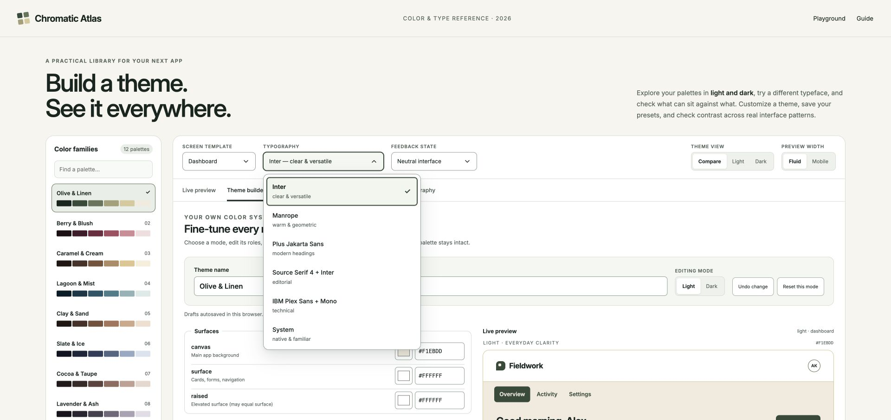

# Chromatic Atlas

A practical color and typography workbench for planning light and dark app themes.



## Try it

Download this repository and open `color-theme-playground.html` in a browser. It includes its fonts, styles, scripts, color data, and license notices, and works offline.

For reliable saved presets, use a stable local server:

```sh
python3 build-site.py
python3 -m http.server 8080 --bind 127.0.0.1 --directory dist
```

Open http://127.0.0.1:8080. Presets stay in that browser and origin; export them before moving the site or clearing browser data.

## What is included

- 12 palette families, 71 unique source colors, and independent light/dark recipes.
- A theme builder with 17 editable roles per mode, Undo, and reset controls.
- Named presets with local storage and validated JSON import/export.
- A live contrast audit with measured suggestions: 66 relationships per theme.
- Dashboard, shopping, reading, and mobile-planner previews.
- A component gallery covering controls, forms, tables, charts, dialogs, and feedback.
- Six typography directions, custom keyboard-accessible menus, and CSS/token exports.
- An editable 21-page FigCraft atlas, original token files, complete color-pair data, and native previews.

## Develop and deploy

Edit `src/` and run `python3 build-site.py`. The Python standard-library build generates both the standalone HTML and `dist/index.html`; no package installation or backend is required.

```sh
node --test tests/*.test.cjs
```

Publish **only `dist/`** to a static host. See [DEPLOY.txt](DEPLOY.txt) for server settings and [START-HERE.txt](START-HERE.txt) for the complete reference map.

## Scope

Contrast calculations use opaque sRGB values. Passing the listed pairs does not certify an entire application's accessibility. Check rendered states, images, transparency, focus, layout, and assistive technology in your own app. Demo interactions process no payments and send no messages.

Color values were transcribed from supplied palette references; the original screenshots are not redistributed. [verification.json](verification.json) records test coverage and its limits.

## License

Original project code and documentation use the [MIT License](LICENSE). Bundled fonts retain their [SIL Open Font License notices](font-licenses/); those notices are also embedded in the standalone HTML.
